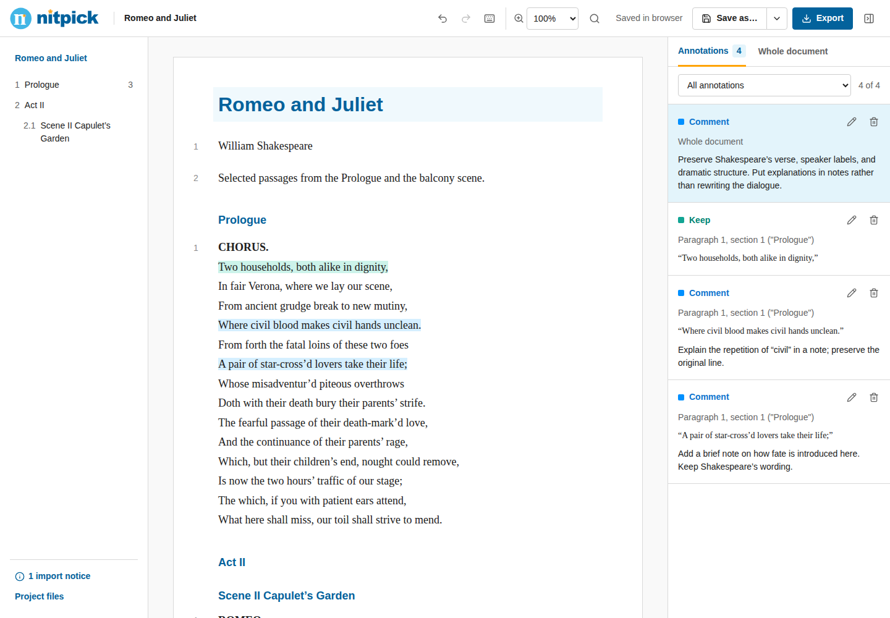
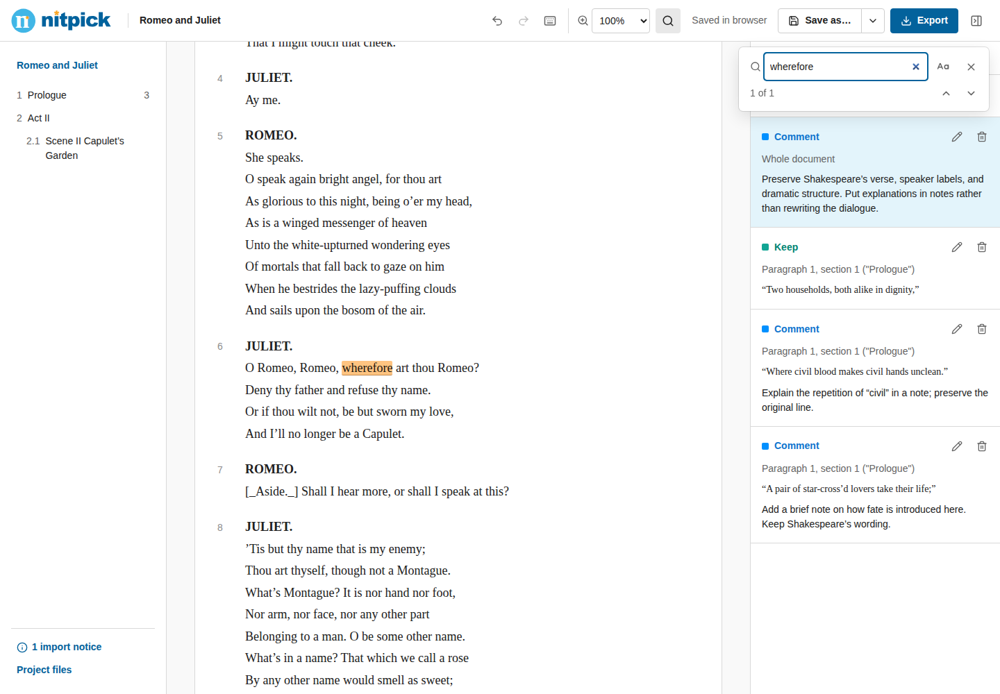
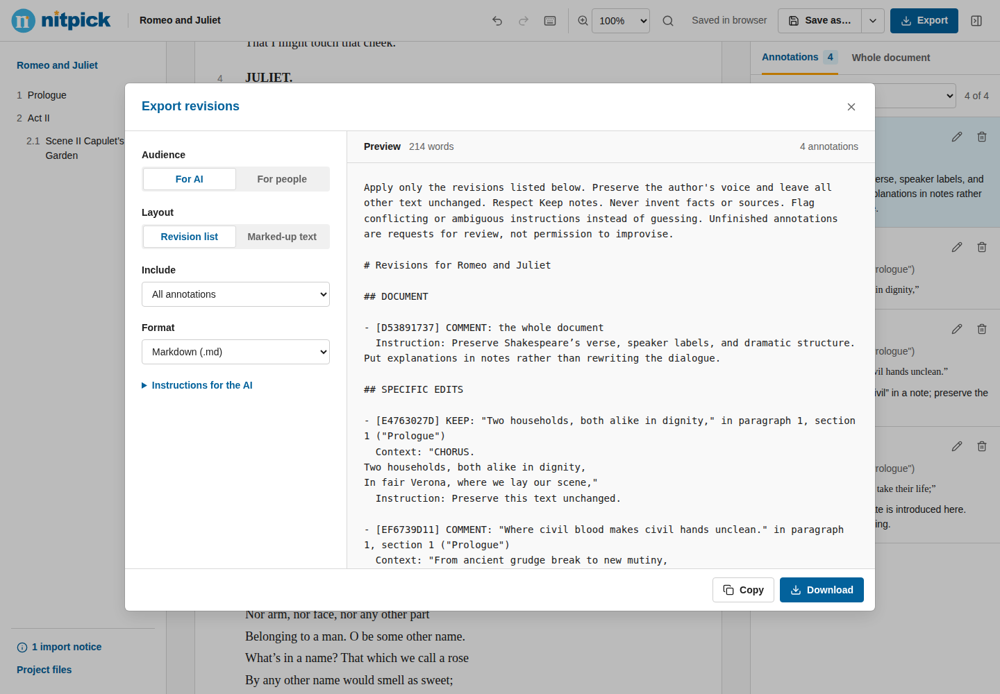

<p align="center">
  
</p>
<p align="center">
  <strong>A little more precise.</strong><br />
  Read closely. Mark what matters. Export clear revision instructions.
</p>
<p align="center">
  
  
  
  <a href="https://github.com/EthanShenx/nitpick/actions/workflows/documentation.yml"></a>
</p>

Nitpick is a private workspace for annotating essays and preparing revisions for **a person, an AI, or both**. The document stays immutable. Nitpick records your instructions and exports them; it never edits the original or calls an AI.



<p align="center"><sub>A real Word import, with the original verse, section counts, global guidance, and independent annotations.</sub></p>

<details>
<summary><strong>See search and export snapshots</strong></summary>

**Find a word or sentence without leaving the document.**



**Preview complete, located revision instructions before copying or downloading.**



</details>

## From reading to revision

1. **Open** a document and read it in a locked, paper-like view.
2. **Annotate** a selection, paragraph, section, or the whole document.
3. **Export** the changes in the format your next step needs.

**Delete · Replace · Insert · Move · Comment · Keep · Verify**

Overlapping notes stay independent. Every list export preserves the complete selected quote and its location, including long selections across paragraphs. LaTeX AI exports quote the original source. Keep notes protect wording, uncertain Moves remain explicit, and Verify asks for evidence instead of inventing it.

## Read your way

- **Mouse or keyboard.** An icon-and-word selection toolbar; **D R I M C K V** shortcuts; Unicode and Chinese support with IME-safe shortcuts.
- **Find and focus.** Upper-right search, match navigation, 50–200% document zoom, and draggable column dividers.
- **Review at every scale.** Nested outline with revision counts, searchable reading text, annotation filters, global suggestions, saved reusable notes, and undo/redo.
- **Pause anywhere.** IndexedDB autosave includes unfinished notes, reading position, filters, zoom, and column widths. Recent documents can be reopened or moved to recoverable trash.
- **Take it with you.** A portable **`.nitpick`** file bundles the original document, included assets, annotations, notes, and settings. File autosave updates the chosen project where the File System Access API is available; other browsers download copies. **Save As** chooses a new destination.

## Bring your document

| Format | Reading view |
| :--- | :--- |
| **Word** `.docx` | Text, headings, common formatting, and embedded images |
| **Markdown** `.md` | CommonMark with source anchors |
| **HTML** `.html` / `.htm` | Clean reading copy; embedded raster images; scripts and original styles stay inactive |
| **LaTeX** `.tex`, folder, `.zip` | Selectable HTML, KaTeX math, included files, figures, and nested headings |
| **PDF** `.pdf` **(experimental)** | Original pages with text selections and area annotations; no OCR |

Complex Word/HTML layouts are simplified. LaTeX is a conservative reading renderer, not a TeX engine; unsupported content stays visible as labeled, selectable placeholders. External resources are not fetched. See the [supported features and limitations](docs/USER-GUIDE.md).

## Export for the next step

| Audience | Revision list | In-place layout |
| :--- | :--- | :--- |
| **AI** | Markdown or JSON with stable IDs, full quotes, locations, context, and editable instructions | CriticMarkup |
| **People** | Readable Markdown or Word | Standalone printable HTML; annotated PDF for PDF documents |

Use **Small edits** for selected-text Delete, Replace, and Insert notes; **Larger changes** includes everything else. Handle small edits manually and send the larger list to an AI. Export works even while a review is unfinished. Nitpick exports a prompt; you choose where to use it.

## Quick start

Requires **Node.js 22.18+**.

```sh
git clone https://github.com/EthanShenx/nitpick.git
cd nitpick
npm ci
npm run dev
```

Open **http://127.0.0.1:5173/**. Run `npm run build` to produce `dist/` for static hosting. No backend, account, API key, or document-upload service is required. Use localhost or HTTPS for file and clipboard features, and keep a consistent origin for browser storage.

## Try the Word example

Download [Romeo and Juliet.docx](samples/Romeo%20and%20Juliet.docx), open it in Nitpick, and add your own notes. The example contains public-domain passages by William Shakespeare; [source details](samples/SOURCES.md) are included. The screenshot capture script imports this actual Word file and creates the demo annotations through the app.

## Development

```sh
npm test                         # Anchors, imports, saving, exports, search, layout
npm run build                    # TypeScript checks and production bundle
npm run spike                    # LaTeX source-mapping spike
npx playwright install chromium
npm run test:e2e                  # Full browser specifications
npm run screenshots:readme        # Reproduce the documentation screenshots
```

The [documentation workflow](.github/workflows/documentation.yml) verifies the build and captures screenshots in an isolated browser. For check results and remaining limits, see [VERIFICATION.md](VERIFICATION.md).

[User guide](docs/USER-GUIDE.md) · [Project format](docs/USER-GUIDE.md#autosave-and-portable-projects) · [LaTeX spike](LATEX-SPIKE.md) · [Dependency review](DEPENDENCIES.md) · [Third-party notices](public/THIRD-PARTY-NOTICES.txt)

The project has no distribution license selected yet. Dependency notices and the public-domain example retain their own terms.
